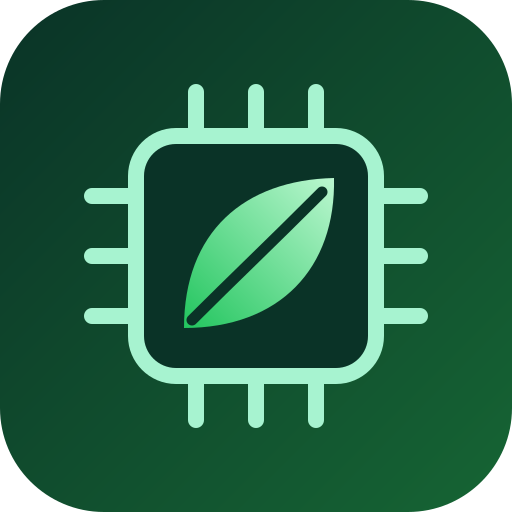
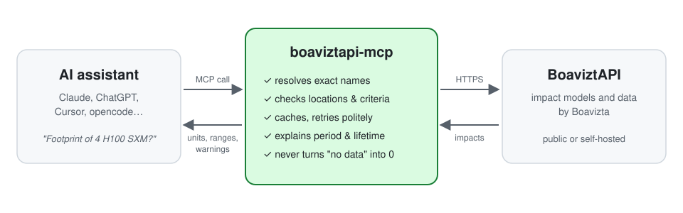
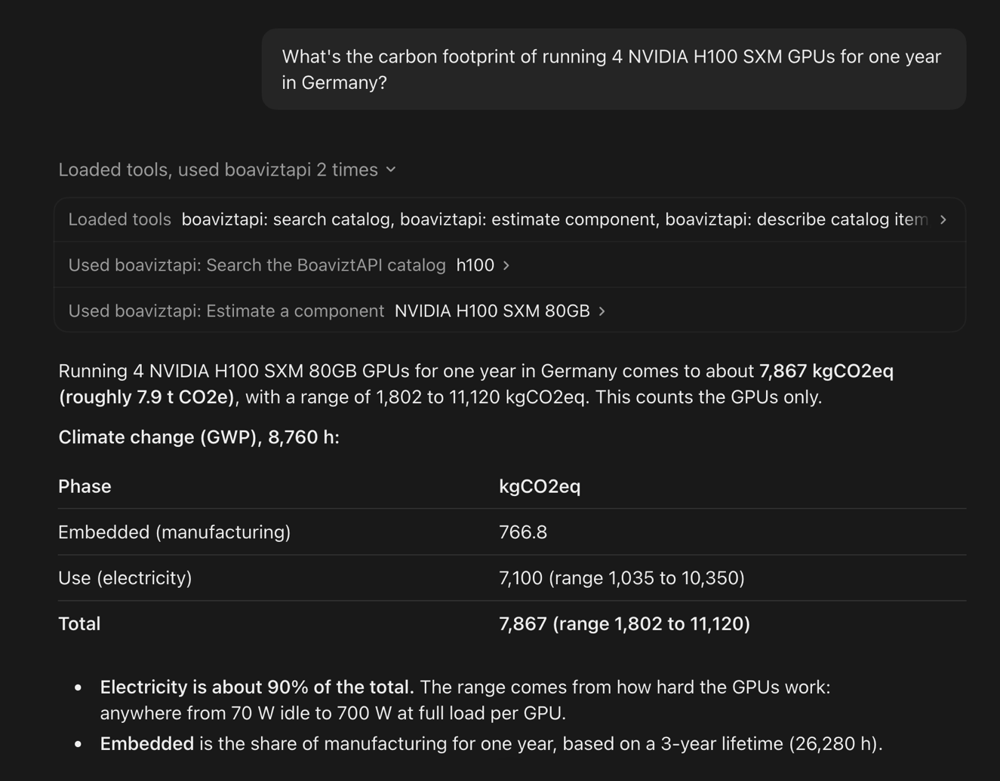

<p align="center">
  
</p>

# boaviztapi-mcp

[](https://github.com/malikmalikayesha/boaviztapi-mcp/actions/workflows/ci.yml)
[](https://pypi.org/project/boaviztapi-mcp/)
[](LICENSE)
[](https://glama.ai/mcp/servers/malikmalikayesha/boaviztapi-mcp)

<!-- mcp-name: io.github.malikmalikayesha/boaviztapi-mcp -->

An [MCP](https://modelcontextprotocol.io) server that lets AI assistants answer questions about the environmental footprint of IT hardware: cloud instances, servers, GPUs and other components, and end-user devices. It asks [BoaviztAPI](https://github.com/Boavizta/boaviztapi) and reports the answer with units, uncertainty ranges and caveats.

> Unofficial community project. Every number comes from BoaviztAPI, built by [Boavizta](https://boavizta.org). See their [methodology documentation](https://doc.api.boavizta.org) for how impacts are computed.

<picture>
  <source media="(prefers-color-scheme: dark)" srcset="https://raw.githubusercontent.com/malikmalikayesha/boaviztapi-mcp/main/assets/how-it-works-dark.svg">
  
</picture>

## Quick start

You need [uv](https://docs.astral.sh/uv/). The server talks to the public BoaviztAPI instance by default; see [Configuration](#configuration) to use your own.

**Claude Desktop, Cursor and other clients with an `mcpServers` config:**

```json
{
  "mcpServers": {
    "boaviztapi": {
      "command": "uvx",
      "args": ["boaviztapi-mcp"]
    }
  }
}
```

To use your own BoaviztAPI instance, add `"env": {"BOAVIZTAPI_URL": "http://localhost:5000"}` next to `args`.

**Claude Code:**

```bash
claude mcp add boaviztapi -- uvx boaviztapi-mcp
```

Add `-e BOAVIZTAPI_URL=http://localhost:5000` before `--` to use your own instance.

**Docker**, from a clone of this repository:

```bash
docker build -t boaviztapi-mcp .
docker run -i --rm boaviztapi-mcp
```

Pass `-e BOAVIZTAPI_URL=...` to `docker run` to change the instance. Inside a container, `localhost` is the container itself; use `host.docker.internal` (Docker Desktop) to reach an instance on your machine.

**From source**, without installing a release:

```bash
uvx --from git+https://github.com/malikmalikayesha/boaviztapi-mcp boaviztapi-mcp
```

**Try it without a client** using the [MCP Inspector](https://github.com/modelcontextprotocol/inspector):

```bash
npx @modelcontextprotocol/inspector uvx boaviztapi-mcp
```

## What you can ask

- "What is the footprint of 4 H100 SXM GPUs running for a year in Germany?"
- "Compare an AWS m5.xlarge in France and in the US over a month."
- "What is the embedded carbon of a typical laptop?"
- "Which is greener in eu-west-3 at 50% load: m5.xlarge or c5.2xlarge?"
- "What would a server with 2x Xeon Gold 6134 and 384 GB RAM emit over 5 years in France?"
- "What does `adp` mean and what unit is it in?"

The first question in Claude Desktop, with the server's tools doing the lookup and the estimate:

<p align="center">
  
</p>

The same answer as the server returns it (the `summary` field of `estimate_component`):

```
4x NVIDIA H100 SXM 80GB, over 8760 h (1 year), in Germany (DEU)
Embedded = the share of manufacturing allocated to 8760 h of a 26280 h lifetime.
gwp, Total climate change (kgCO2eq):
  embedded: 766.8
  use: 7100 (range 1035 to 10350)
  total: 7867 (range 1802 to 11120)
adp, Use of minerals and fossil ressources (kgSbeq):
  embedded: 0.007776
  use: 0.0015 (range 0.0002155 to 0.002155)
  total: 0.009276 (range 0.007992 to 0.009931)
pe, Consumption of primary energy (MJ):
  embedded: 10550
  use: 270000 (range 39880 to 398800)
  total: 280600 (range 50430 to 409400)
Assumptions: units 4, TDP 700 W, average power 479.5 W (range 70 to 700), load 65 % (range 0 to 100), use time ratio 1, lifetime 26280 hours, grid carbon intensity 0.422 kg CO2eq/kWh.
Note: GPU 'h100 sxm' was read as NVIDIA H100 SXM 80GB.
Note: GPU only; the host server is not included. Use estimate_server with a gpu block for a whole system.
Source: BoaviztAPI 2.6.0 at https://api.boavizta.org
```

A comparison (`compare_estimates`, first criterion shown):

```
Comparison over 8760 h (1 year):
- m5.xlarge: aws m5.xlarge, over 8760 h (1 year), in eu-west-3 (FRA)
- c5.2xlarge: aws c5.2xlarge, over 8760 h (1 year), in eu-west-3 (FRA)
gwp (kgCO2eq):
  m5.xlarge: total 27.4 (range 22.14 to 36.68)
  c5.2xlarge: total 61 (range 51.06 to 77.16), +122.6% vs m5.xlarge
  Lowest: m5.xlarge (ranges do not overlap).
```

## Tools

All tools are read-only and carry the matching annotations and a display title. Each returns structured content (with an output schema) plus a plain-text `summary`.

The server speaks the current MCP specification, [2026-07-28](https://modelcontextprotocol.io/specification/2026-07-28) (stateless, with `server/discover`), and still accepts the `2025-11-25` handshake used by older clients. It uses none of the features deprecated in 2026-07-28 (logging, sampling, roots).

| Tool | What it does | Key inputs |
|---|---|---|
| `list_impact_criteria` | Explains impact criteria codes and units | `query` |
| `search_catalog` | Finds exact names before estimating | `kind` (cloud_provider, cloud_instance, cloud_region, server_archetype, device_archetype, gpu, cpu, country), `query`, `provider`, `device_type` |
| `describe_catalog_item` | Shows what an instance, archetype, GPU or CPU contains | `kind`, `name` |
| `estimate_cloud_instance` | Footprint of one cloud VM | `provider`, `instance_type`, `region` or `usage_location`, `load_percent` |
| `estimate_server` | Footprint of an on-premise server, optionally with GPUs | `archetype`, `cpu`, `ram`, `disks`, `gpu`, usage fields |
| `estimate_component` | Footprint of one GPU, CPU, RAM module, SSD or HDD | `component`, `name`, `units`, `capacity_gb` |
| `estimate_device` | Footprint of a laptop, phone, monitor, IoT device and 9 other types | `device_type`, `archetype` |
| `compare_estimates` | Ranks 2 to 5 options over the same period | `items`, `duration_hours` |

The estimate tools also take `duration_hours`, `usage_location`, `criteria` (default `gwp`, `adp`, `pe`) and `detail` (`summary` or `breakdown`). Every parameter, type and default is listed in the [tool reference](docs/tools.md).

Names are matched carefully. "h100 sxm" finds "NVIDIA H100 SXM 80GB", and the result notes the interpretation. A name that could mean several items ("h100") or only partly matches one is refused with a list of candidates, so a missing item is never silently swapped for a similar one.

## Reading the results

- **Embedded vs use.** Embedded is manufacturing (and transport where modelled); use is the electricity consumed. They are always reported separately, with a total only when both are numbers.
- **Period.** Without `duration_hours`, figures cover the whole hardware lifetime. With it, embedded is the share of manufacturing for that period and use is the energy for that period. If the period is longer than the lifetime, BoaviztAPI counts manufacturing once; the result says so.
- **Ranges.** `(range a to b)` is BoaviztAPI's min and max. When two options' ranges overlap, `compare_estimates` says the ranking is not certain.
- **Location.** Use-phase impacts depend on the electricity mix. Without a location BoaviztAPI uses a European default with a wide range, and the result suggests passing a country.
- **"not available from BoaviztAPI for this item"** means there is no data for that criterion and phase. It is never a zero.
- **Warnings** such as "End of life is not included in the calculation" stay next to the phase they belong to.

## Configuration

| Variable | Default | Meaning |
|---|---|---|
| `BOAVIZTAPI_URL` | `https://api.boavizta.org` | BoaviztAPI base URL |
| `BOAVIZTAPI_TIMEOUT` | `20` | Seconds per request |
| `BOAVIZTAPI_DEFAULT_CRITERIA` | `gwp,adp,pe` | Criteria used when a call names none |
| `BOAVIZTAPI_CACHE_TTL` | `86400` | Seconds to cache list and lookup responses; `0` disables caching |

### Self-host BoaviztAPI for regular use

The public instance is a demo. For anything beyond occasional questions, run your own:

```bash
docker run -p 5000:5000 ghcr.io/boavizta/boaviztapi:latest
```

then set `BOAVIZTAPI_URL=http://localhost:5000` in the server's environment. The server is polite either way: it identifies itself in the `User-Agent`, caches lists and recent estimates, sends at most four requests at a time, and retries only transient failures.

## Upstream behaviour this server works around

Found while building this against BoaviztAPI 2.6.0. Each one has a live test that will start failing (on purpose) when upstream changes it.

- Unknown criteria and `criteria=all` return HTTP 500, so criteria are checked locally and `all` is refused.
- Unknown locations and cloud regions are accepted without an error and give generic results, so both are checked against the API's own lists.
- `name_to_gpu` silently picks one GPU for an ambiguous name and returns 200 with a plain string when nothing matches, so names are resolved here and ambiguous ones are refused.
- An `iot_device` without an archetype reports 0 for manufacturing, so an archetype is required.
- The GPU endpoint returns 500 for some criteria on the public instance (fixed upstream in [Boavizta/boaviztapi#621](https://github.com/Boavizta/boaviztapi/pull/621), not yet deployed). A failing multi-criteria request is retried one criterion at a time, and only the failing criteria are marked as errors.

## Privacy

The server sends BoaviztAPI only what the tool call contains: hardware names and specifications, locations, durations and criteria. Requests go to `BOAVIZTAPI_URL` and nowhere else, with a `User-Agent` naming this package. There is no telemetry and nothing is written to disk; caches live in memory and end with the process. Logs go to stderr.

## Limitations

- Figures are BoaviztAPI's model estimates, with ranges that can be wide. Treat them as orders of magnitude for comparing options, not as measurements.
- A cloud instance's footprint is its share of the host server; networking, storage services and data centre overheads beyond BoaviztAPI's model are not included.
- Not exposed yet: custom electricity factors, workload time series, standalone motherboards, power supplies and cases, IoT functional blocks, and CPU consumption profiles.
- The public BoaviztAPI instance is a demo without guaranteed availability. Self-host for anything regular.

## Troubleshooting

| Symptom | What to do |
|---|---|
| "BoaviztAPI ... did not respond" | The instance is down or slow. Raise `BOAVIZTAPI_TIMEOUT`, or self-host and set `BOAVIZTAPI_URL`. |
| "Unknown GPU / CPU / instance type / location ..." | The message lists close matches. Use `search_catalog` to find the exact name. |
| "... matches N names" | The name is ambiguous; pick one of the listed exact names. |
| "BoaviztAPI failed (HTTP 500) for: ..." | Upstream cannot compute that criterion for this item. Other criteria are still returned. |
| Numbers differ from another BoaviztAPI front end | Check the BoaviztAPI version in the result's last line; methods and data change between releases. |
| The client shows no tools | Run `uvx boaviztapi-mcp --version` in a terminal to check it starts, then look at the client's MCP log. |

## Development

```bash
uv sync
uv run pytest                 # unit and tool tests, replaying recorded responses
uv run ruff check . && uv run ruff format --check . && uv run pyright
```

- **Recorded responses** live in `tests/fixtures/`. Re-record them after a BoaviztAPI release with `uv run python scripts/record_fixtures.py --clean` and review the diff.
- **Summaries** are checked against `tests/golden/`; regenerate them with `UPDATE_GOLDEN=1 uv run pytest tests/unit/test_formatting.py`.
- **Live tests** run against a real instance: start the Docker image above, then `BOAVIZTAPI_URL=http://localhost:5000 uv run pytest -m live -rxX`.
- **Tool reference**: `docs/tools.md` is generated from the tool schemas with `uv run python scripts/gen_tool_docs.py`; a test fails if it is out of date.

See [CONTRIBUTING.md](CONTRIBUTING.md). Security issues: see [SECURITY.md](SECURITY.md).

## License

Apache-2.0. BoaviztAPI itself is AGPL-3.0 and is not bundled; see [NOTICE](NOTICE).
